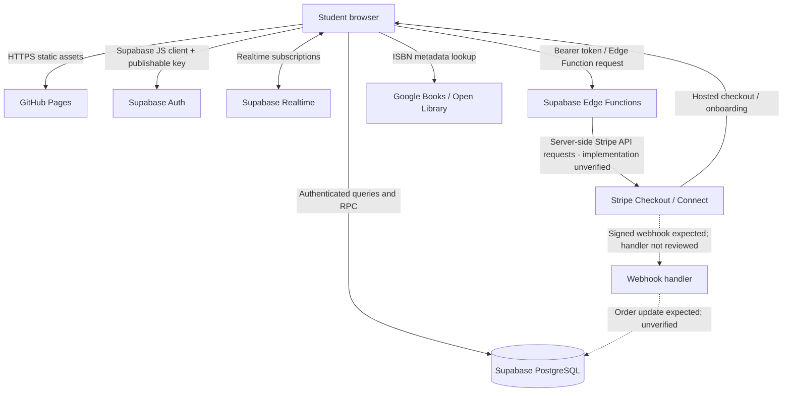
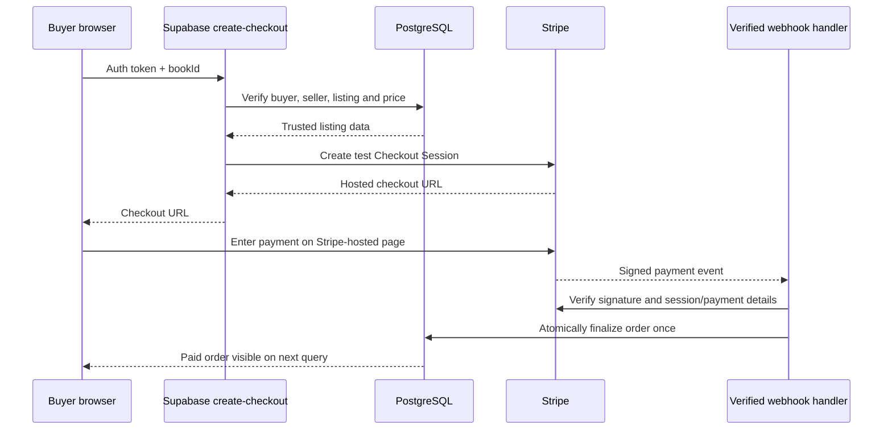

# Bookaroo architecture

**Scope:** Documentation based on the supplied Bookaroo frontend (`index.html`) and selected SQL setup files. Backend Edge Function source and the live database schema have not been provided, so their internal behavior is **not verified**.

## System diagram

The dotted webhook path is the **required secure design**, not a claim that the deployed implementation has been audited.

## Components

| Component | Responsibility | Trust boundary |
| --- | --- | --- |
| `index.html` | Responsive UI, validation for usability, page state, account dashboard, listing and checkout actions | Public code; must never be trusted for authorization or pricing |
| GitHub Pages | Serves static frontend | No trusted backend logic or secrets |
| Supabase Auth | Account sessions and JWTs | Server must validate token and permissions |
| Supabase PostgreSQL | Listings, profiles, favorites, reviews, reports, orders, messages and notifications | RLS and secure RPCs must enforce access |
| Supabase Realtime | Pushes changes to clients | Publications and RLS require review |
| Supabase Edge Functions | `create-checkout`, `stripe-connect` | Must authenticate users and use server-side trusted values |
| Stripe | Hosted checkout and seller onboarding | Only signed server-to-server webhook should finalize payment state |
| External book APIs | ISBN lookup and book details | Untrusted metadata; escape when displayed |

## Frontend → Supabase

The browser initializes `window.supabase.createClient(SUPABASE_URL, SUPABASE_PUBLISHABLE_KEY)`. The publishable key is intended for browser use; a **service-role key is not**. Users sign in through Supabase Auth; the client subsequently makes table queries and calls RPC functions. Examples visible in the frontend include `bookaroo_is_admin`, `bookaroo_admin_reports`, `bookaroo_admin_manage_listing`, `bookaroo_admin_set_moderator`, and `bookaroo_start_conversation`.

**Security rule:** Hiding an admin button is a UX feature, not a security control. RLS and RPCs must independently reject unauthorized requests. The presence of a client-side `@ttu.edu` check is not proof that verified-email restrictions are enforced in the database.

The messaging frontend reads `book_conversations` and `book_messages` and writes messages to `book_messages`. A supplied SQL migration defines participant-only RLS; its installation and compatibility with the live schema are unverified. The frontend also uses Supabase Realtime and a periodic refresh fallback.

## Frontend → Stripe

The frontend does **not** call Stripe with a secret key. It invokes an authenticated Supabase Edge Function via `POST /functions/v1/create-checkout` with a `bookId`. It expects an HTTPS Stripe Checkout URL and redirects the buyer. For seller onboarding it calls `POST /functions/v1/stripe-connect` and redirects to a Stripe Connect URL.

The frontend does not provide a trusted final payment amount. The Edge Function must fetch the listing and price directly from PostgreSQL, validate seller eligibility and availability, establish the correct Connect destination, and create the Stripe Checkout session. It must not trust a browser-provided price, seller account ID, or order status.

A webhook handler **should** verify Stripe signatures against the raw request body, check payment amount/currency/order association, update the order transactionally, and handle repeated events idempotently. This handler has not been inspected; payment safety remains **unverified**.

## Example purchase sequence (intended design)

This is a target architecture and **not evidence** that every step exists in production.

## Data and authorization boundaries

- **Public listing data:** Read permissions should be explicit; private profile fields must not leak through broad selects.
- **Student accounts:** Only the owner should update their profile, favorites, watches and listings, subject to business rules.
- **Messages:** Only sender and recipient should see a conversation; sender ID must match the authenticated user.
- **Reports:** Only authorized moderators/owners should read the complete report queue.
- **Admins:** Owner-controlled grants/revocations must be checked by database functions, not browser state.
- **Orders:** Only the buyer, seller, and narrowly scoped backend functions should access appropriate fields. Clients must never mark an order paid.
- **Payments:** Stripe credentials and webhook signing secrets must remain server-side.

## Known constraints and status

The frontend is a large single-file HTML/CSS/JavaScript application. This simplifies static deployment but increases the risk of regressions when modifying unrelated features. A future refactor could extract CSS and JS into separate files, introduce automated tests, and adopt a build process; none is required merely to document the current project.

**Payment status:** Stripe test-mode integration is described in the project history. The current live Stripe mode, Edge Function behavior, and webhook setup have **not been independently verified**. Do not claim production readiness.
